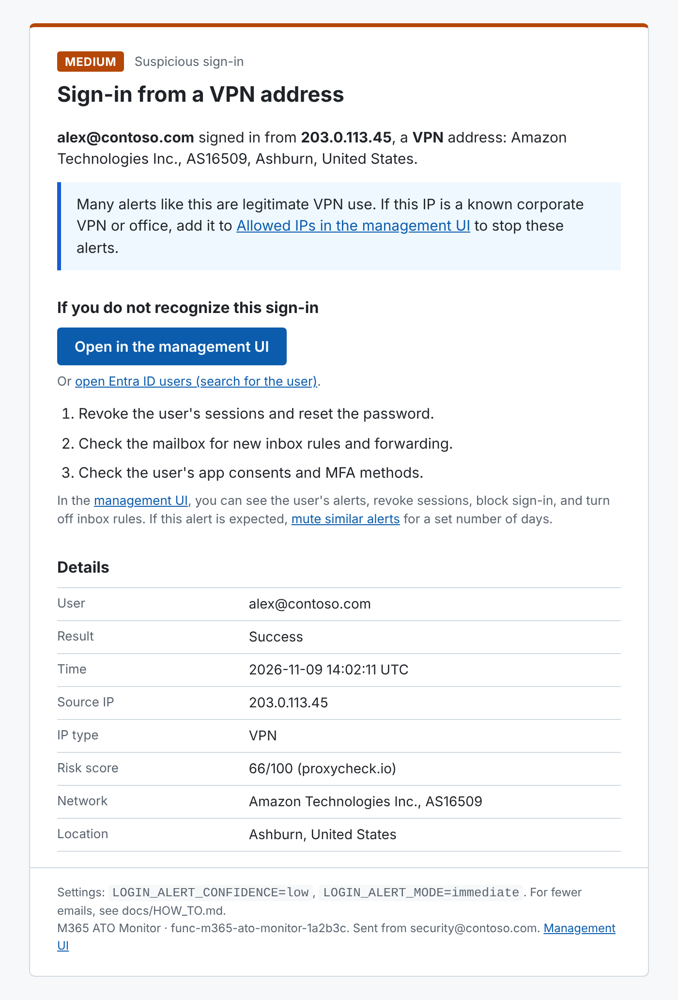

# M365 ATO Monitor

**Account takeover alerts for Microsoft 365, running in your own Azure subscription.**

M365 ATO Monitor reads your tenant's audit log and emails you (and, if you choose, responds automatically) when it finds signs of account takeover. It looks for common attacker actions, such as hiding replies with an inbox rule, forwarding mail, signing in from a suspicious network, adding an MFA method, or giving an app access to mail.

Microsoft's automated response to risky sign-ins needs Entra ID P2, and Business Premium includes only P1. Business Basic and Business Standard include neither.

This monitor gives every license alerts and an optional [automatic response](#automatic-response). It runs in your own Azure subscription and costs a few dollars a month for a small tenant.

> [!IMPORTANT]
> **This is not real-time protection.** The monitor sees an event only after Microsoft publishes its audit record. Many records arrive within about 10 minutes, but Microsoft does not guarantee a time, and some take 1–2 hours or more. The monitor checks for new records every 2 minutes. The optional automatic response can act only after the record arrives.

[Install](#install) · [Automatic response](#automatic-response) · [What it detects](#what-it-detects) · [Limits](#what-it-does-not-detect) · [Documentation](#documentation)


## How it works

An Azure Function in your subscription reads the unified audit log through the Office 365 Management Activity API. It checks each record for suspicious activity and looks up the reputation of sign-in IP addresses at proxycheck.io.

The monitor emails each finding from your alert mailbox. The email says how to investigate and lists the other alerts for the same user in the last 24 hours. The management UI shows the alerts, the health of the monitor, and the settings.

The app signs in with a managed identity, so there is no client secret to store or rotate. Audit records stay in Microsoft 365. The monitor keeps one row per alert for 90 days. It sends only IP addresses to proxycheck.io.

### Example alert

A user signed in from a VPN address in Amazon's network. The details are not real.

```text
Subject: [M365 Alert] MEDIUM: Suspicious sign-in - alex@contoso.com from 203.0.113.45, success
```



The button opens the user's page in the management UI. That page shows the user's other alerts, and has buttons to revoke sessions, block sign-in, and turn off inbox rules.

## Requirements

| Requirement | Details |
| --- | --- |
| Microsoft 365 tenant | Business Basic or higher, or Office 365 E1, E3, or E5 |
| Audit logging | Unified audit logging on. It is off by default in Business plans: [turn it on](#turn-on-audit-logging) |
| Azure subscription | In the same tenant, with the Owner role |
| Admin role | Global Administrator, one time. Or Privileged Role Administrator (to grant the app's permissions) and Exchange Administrator (to limit Mail.Send to the alert mailbox) |
| Alert mailbox | A licensed or shared mailbox. The monitor sends every email as this mailbox. With the default `-MailSendScope mailbox`, it can send as no other mailbox |
| Tools | PowerShell 7.2 or later and Azure CLI 2.60 or later, or Azure Cloud Shell, which has both |

**Commercial cloud only.** GCC, GCC High, DoD, and China are not supported.

Many Business tenants have no Azure subscription yet. Adding one takes about 10 minutes: a pay-as-you-go sign-up, or, if your organization already pays Microsoft under a Microsoft Customer Agreement, a new subscription on that billing account. See [Get an Azure subscription](docs/GETTING_STARTED.md#get-an-azure-subscription). [Getting Started](docs/GETTING_STARTED.md#1-prerequisites) shows how to check each requirement.

### Turn on audit logging

Audit logging is off by default in tenants with Business Basic, Business Standard, or Business Premium licenses, and in trial tenants of enterprise licenses ([Microsoft Learn](https://learn.microsoft.com/purview/audit-log-enable-disable)). Other tenants have it on. An admin or a partner can change it at any time, so check it in every tenant, old or new.

In the Microsoft Purview portal:

1. Open the [Microsoft Purview portal](https://purview.microsoft.com) and go to **Solutions > Audit**.
2. If the page shows **Start recording user and admin activity**, select it. If it does not, audit logging is on.

Or in PowerShell, as a Global Administrator or Exchange Administrator:

```powershell
Install-Module ExchangeOnlineManagement -Scope CurrentUser
Connect-ExchangeOnline
Get-AdminAuditLogConfig | Format-List UnifiedAuditLogIngestionEnabled
Set-AdminAuditLogConfig -UnifiedAuditLogIngestionEnabled $true
```

Recording starts within 60 minutes.

In a new tenant, both ways can fail with a message to run `Enable-OrganizationCustomization` first. To save space, Microsoft stores some objects of a new tenant in a shared ("dehydrated") form until this command runs once. Run it, then run `Set-AdminAuditLogConfig` again:

```powershell
Enable-OrganizationCustomization
Set-AdminAuditLogConfig -UnifiedAuditLogIngestionEnabled $true
```

Microsoft does not say how long `Enable-OrganizationCustomization` takes. Admins report from some minutes to several hours, and sometimes longer. Until it is done, `Set-AdminAuditLogConfig` fails with the same message: wait, then run it again.

## Set up your environment

### Windows

```powershell
winget install --id Microsoft.PowerShell --source winget
winget install --id Microsoft.AzureCLI --source winget
winget install --id Git.Git --source winget
```

Then open **PowerShell 7** (`pwsh`) from the Start menu.

### macOS

```bash
brew install powershell azure-cli
pwsh
```

### Linux

Install [PowerShell](https://learn.microsoft.com/powershell/scripting/install/installing-powershell-on-linux) and the [Azure CLI](https://learn.microsoft.com/cli/azure/install-azure-cli-linux), then run `pwsh`.

### Azure Cloud Shell

Open [Azure Cloud Shell](https://shell.azure.com) and select **PowerShell**. It has both tools, and you are already signed in.

### Get the code

```powershell
git clone https://github.com/Adversis/m365-ato-monitor.git
cd m365-ato-monitor
if ($IsWindows) { Get-ChildItem -Recurse -Filter *.ps1 | Unblock-File }
```

## Install

In PowerShell 7, in the project folder:

```powershell
./install.ps1 -AdminEmail security@contoso.com -Location eastus
```

The script signs in to Azure, shows a plan, and asks before it changes anything. It creates the Azure resources and two app registrations, grants the permissions, deploys the code, and checks that the monitor answers. To limit Mail.Send to the alert mailbox, it also signs in to Exchange Online (it shows a URL and a code: open the URL in any browser, also on another computer) and makes a hidden group, `m365-ato-monitor-senders`, with the alert mailbox as the member. To change the alert mailbox later, add the new mailbox to that group, then change it in the management UI ([How-To](docs/HOW_TO.md#change-the-alert-mailbox)). Then it waits up to 10 minutes for the first monitor run, tests each alert type, and asks if it should send one test email for each alert type. Press Ctrl+C to stop the wait: the install is complete at that point.

To see each change without making any, add `-DryRun`. `./install.ps1 -Help` lists the commands and options.

If a step fails, the script says how to fix it. After the fix, run the same command again: it continues from what exists.

| Command | What it does |
| --- | --- |
| `./install.ps1 -Update` | Deploy new code and repair the setup. Keeps your settings |
| `./install.ps1 -Verify` | Show the status of the monitor and test each check on a synthetic record |
| `./install.ps1 -Verify -SendTestAlerts` | Also send one test email for each alert type |
| `./install.ps1 -Uninstall` | Delete the Azure resources and the app registrations |

You do not need `az login` first: the script signs in for you. If the Azure CLI is signed in to another tenant than the one of `-AdminEmail`, the script stops before any change and shows the command for the right tenant.

### Install in another tenant

For a second tenant (and each one after it), add `-Tenant` with a domain of that tenant:

```powershell
./install.ps1 -Tenant fabrikam.com -AdminEmail security@fabrikam.com -Location eastus
```

1. The script signs in to that tenant in the browser. Use an account of that tenant: Owner of an Azure subscription there, and Global Administrator.
2. It selects the Azure subscription of that tenant. If there is more than one, it asks which one.
3. It installs as for the first tenant. For the Exchange Online sign-in, use an account of the same tenant (a private browser window helps if the browser picks another account). The script stops if the sign-in lands in another tenant.
4. The alert subjects start with the organization name, for example `[M365 Alert][Fabrikam]`. Change it in Settings > Email.
5. At the end, the Azure CLI goes back to the subscription that you used before. Your other installations do not change.

Each install and update is saved on this computer (`~/.m365-ato-monitor/tenants.json`: tenant, subscription, name, region; no secrets):

| Command | What it does |
| --- | --- |
| `./install.ps1 -List` | Show your installations |
| `./install.ps1 -Tenant fabrikam.com -Update` | Deploy new code to one installation. `-Verify` and `-Uninstall` take `-Tenant` too |
| `./install.ps1 -UpdateAll` | Deploy new code to each installation, one after the other, with a summary at the end |

An installation made before `-Tenant` existed shows in `-List` after its next `./install.ps1 -Update`.

Step-by-step guide and troubleshooting: [Getting Started](docs/GETTING_STARTED.md).

**Using an AI coding assistant?** Open the project folder in Claude Code, Codex, Cursor, or Copilot and ask it to read [AGENTS.md](AGENTS.md). That file tells the assistant to preview the changes with `-DryRun` and to ask before it changes your tenant.

## After installation

Microsoft starts to deliver audit records 12–24 hours after the first run. A setup email arrives then, and the "Starting state" report follows. The report lists the inbox rules of every mailbox and the findings in up to 180 days of audit history, so that you can find what an attacker did before the install.

Add a mail rule so that mail with `[M365 Alert]` in the subject does not go to junk mail. Optional: get a free [proxycheck.io](https://proxycheck.io/dashboard/) key (1,000 lookups per day; 100 without a key) and enter it in the management UI. The Overview page shows how much of the daily limit is used, and the monitor emails you when it is low or used up. See [What happens when the proxycheck.io quota runs out?](#what-happens-when-the-proxycheckio-quota-runs-out)

A health report arrives each Monday. If it does not arrive, the monitor did not run: run `./install.ps1 -Verify`.

To also get alerts in Slack or Microsoft Teams, or to get them there instead of by email, set a webhook in **Settings > Webhook**. Reports stay in email.

## Automatic response

The monitor can revoke a user's sessions, block sign-in, or turn off an inbox rule after a high alert. It is off by default. To turn it on:

1. Grant the permissions. The install asks for them; the default answer is yes. To grant them later, run `./install.ps1 -ResponsePermissions yes`.
2. In the management UI, go to **Settings > Automatic response** and set:

| Setting | What to choose |
| --- | --- |
| Action on a high account-takeover alert | **Revoke sessions**, or **Block sign-in and revoke sessions** |
| Action on a sign-in from a new country | The same choices. Applies after the 14-day learning period |
| Turn off malicious inbox rules | On: a high inbox rule alert turns the rule off. The rule is kept for investigation |
| Never change these accounts | Break-glass and admin accounts. The alert mailbox is always exempt |
| Maximum account actions per day | A limit, so that a wrong result cannot lock out many users |

The response never changes passwords. It does not act on alerts about admin changes or app consents, and Microsoft Graph refuses changes to admin accounts. It acts only on the account that signed in, or on an account that changed its own mailbox or MFA. A change that one account made to another account gets no action, because either account can be the compromised one. The same actions are also buttons on each user's page in the management UI. Details: [How-To: Respond automatically](docs/HOW_TO.md#respond-automatically-to-account-takeover-alerts).

A wrong-password sign-in never triggers an account action, even if **Email failed sign-ins** is on. A high sign-in alert can trigger an action after a successful sign-in or a correct password stopped by MFA or Conditional Access.

## Management UI

The install prints the address:

```text
https://<function app>.azurewebsites.net/api/manage
```

Sign-in uses Entra ID. The person who runs the install can open the page. To give other people access, list their user names, or select directory roles such as Global Administrator, in **Settings > Management UI access**. The settings page shows who has each role now. To see which account you are signed in with, and why it has access, select your name at the top right.

| Page | What it shows |
| --- | --- |
| **Overview** | The health of the monitor, the alerts of the last 7 days, and tools: test alerts and the onboarding scan |
| **Alerts** | Each alert of the last 90 days, and what happened to it |
| **Users** | One user's alerts, inbox rules, countries, and audit log. Buttons to revoke sessions, block sign-in, or turn off an inbox rule |
| **Mutes** | Stop email for an expected medium alert for some days. High alerts are always sent |
| **Settings** | Alert mailbox and recipients, a webhook for Slack or Teams, allowlists, detection options, the automatic response, the proxycheck.io key, and who can open the management UI |
| **Countries** | The approved countries of each user. Approve a country before a user travels |
| **History** | Each change and action made in the management UI, and who made it |

## What it detects

| Detection | Examples | Severity |
| --- | --- | --- |
| Inbox rules | Forward to an external address; forward to an unverified directory recipient (medium); move mail to a folder that users seldom open; hide mail about payments or security; a rule named `..`. A rule that only deletes mail sends email only after another alert for the user, from a flagged IP, or after a sign-in from a new network in the 24 hours before | High or medium |
| Mailbox forwarding | Forwarding to an external address (high) or an internal address (medium) | High or medium |
| Mail flow (transport) rules | External BCC or redirect; skip spam filtering | High or medium |
| OAuth consent | An app gets mailbox, file, or directory access, such as `Mail.Read` or `full_access_as_app` | High |
| MFA changes | A method added to an account that already has MFA; per-user MFA turned off. A method added by the user or by an admin sends email only if one of them had another alert in the 7 days before, or the person who made the change signed in from a new network in the hour before. Otherwise it is in the alert list with no email. In the first 14 days after an install or update, every such change sends email (the monitor learns each user's networks) | High or medium |
| Admin roles | Global Administrator or another admin role assigned | High or medium |
| Mailbox delegation | Full Access or Send As granted; a folder shared with everyone | Medium |
| App credentials | A secret or certificate added to an app registration | Medium |
| Domains and federation | Federation set on a domain; a domain added | High or medium |
| Protection turned off | Unified audit logging off; external auto-forwarding allowed; an anti-phishing policy removed | High or medium |
| Risky sign-in methods | Legacy authentication (password only, no MFA); device code sign-in; an attack tool or a scripting library in the user agent. A failed sign-in (wrong password) sends email only if you turn on **Email failed sign-ins** | High or medium |
| Suspicious sign-in IP | A sign-in from a VPN, Tor, proxy, or hosting address. A failed sign-in (wrong password) sends email only if you turn on **Email failed sign-ins**. A correct password stopped by MFA always sends email | Low to high |
| New country | A successful sign-in from a country that is new for the user. The monitor learns each user's countries for 14 days first | High |
| Stolen session | One sign-in session used from two countries, or used in the same country from a VPN, proxy, hosting, or Tor IP that did not sign in | High or medium |
| Mail access from a risky IP | Mail read or sent from a VPN, proxy, hosting, or new-country IP that did not sign in as the user in the last 7 days | High or medium |

Most findings become high if the source IP is a VPN, proxy, or hosting address, or is in a country that is new for the user. You can turn off each alert type.

How each check works: [Architecture](docs/ARCHITECTURE.md#compromise-check). How to investigate each alert: [Alert Triage](docs/TRIAGE.md).

## What it does not detect

- AiTM phishing through a residential proxy in the user's own country. The monitor detects the attacker's next steps instead: inbox rules, forwarding, MFA changes, and app consents.
- A stolen session used from a normal home or office network in the user's own country.
- Session and mail access activity from Microsoft 365's own servers, for example Teams, Copilot, or Outlook mobile acting for the user. The record then shows a Microsoft IP, not the client's. The monitor skips these records: IPs from Microsoft's published lists (without the Azure ranges that customers can use), and records that a Microsoft-owned app wrote for the user's app. Such an IP also does not make an alert high.
- Mail read with a stolen token, if the tenant does not log `MailItemsAccessed`. Business plans may not log it. The Overview page shows if your tenant does.
- Passkey and FIDO2 registration, and SharePoint, OneDrive, and Teams activity.
- A new device, browser, or mail client.
- Risk scores and Conditional Access results from Entra ID P1/P2 or Defender.

Full list: [Architecture: detection limits](docs/ARCHITECTURE.md#detection-limits).

## Cost

About $2–10 per month for a small tenant, mostly for the Function App and the logs. The change alerts add less than $1. Breakdown: [Architecture: costs](docs/ARCHITECTURE.md#costs). To get a warning, set a Cost Management budget on the resource group.

## FAQ

### Does it work with Entra ID P1 or P2?

Yes. It reads the audit log, which every plan has. With P2, Entra ID Protection also scores risky sign-ins and can respond to them. The monitor still adds alerts for mailbox and tenant changes, such as inbox rules, forwarding, and app consents.

### Does it block attacks?

No. It reports suspicious activity after Microsoft publishes the audit record: often within minutes, sometimes 1–2 hours or more. The [automatic response](#automatic-response) acts after an alert.

To stop attacks at sign-in, use Microsoft's controls. Security Defaults (free) require MFA, and block legacy authentication and device code sign-in. They do not check sign-in risk ([Microsoft Learn](https://learn.microsoft.com/entra/fundamentals/security-defaults)). Conditional Access (Entra ID P1) can block sign-ins by location, device, or app. Blocking by sign-in risk needs Entra ID P2.

### What permissions does it need?

Read access to the audit log, users, inbox rules, directory role assignments, and service principals, and `Mail.Send` to send the alerts. You can limit `Mail.Send` to the alert mailbox. The automatic response needs more permissions. The install asks before it grants them.

Full list: [Security](docs/SECURITY.md#permissions).

### What happens when the proxycheck.io quota runs out?

proxycheck.io allows 100 IP lookups per day without a key, 1,000 with a free key, and more with a paid plan. Each new IP is one lookup. The monitor keeps the answer for a clean IP (office, home, mobile) for 7 days, and for a flagged IP (VPN, proxy, hosting, Tor) for 24 hours. To change the 7 days: **Settings > Advanced > Keep clean IP lookups**. When the limit is used up:

| Check | What happens |
| --- | --- |
| Suspicious sign-ins and new countries | The sign-in waits in a queue. Each run checks it again, for up to 26 hours. The alert comes late |
| Stolen session and mail access | Records whose IP lookup fails are skipped after about 8 minutes. These alerts are lost, unless the session is used again after the quota is back |
| Account takeover alerts (inbox rules, forwarding, MFA, app consent, and others) | Still sent, but without the IP reputation. An alert from a risky IP is not raised to high |

The monitor emails you when the quota is low and again when it is used up, at most once a day for each. The Overview page shows the state. With a key, it also shows the count of lookups used today, if **Dashboard API Access** is on in the proxycheck.io dashboard.

### Can an MSP monitor many tenants?

Yes, with one install per tenant, each in an Azure subscription of that tenant. Install each customer with `./install.ps1 -Tenant <customer domain> ...` ([Install in another tenant](#install-in-another-tenant)), see them with `-List`, and update them all with `-UpdateAll`. The alert subjects carry each customer's name. Add your ticket system or your own mailbox as an extra recipient in each installation (Settings > Email). Each customer pays for and owns their own installation and data.

### How does it compare with other options?

Microsoft Purview has some built-in alert policies. Use them as well. Entra ID P2 adds risk-based detection and response, and Defender adds more. A SIEM is more flexible but needs ongoing work.

## Development

`make check` runs all linters and tests. `make docker-check` runs them in a dev container with pinned tool versions.

See [Development](docs/DEVELOPMENT.md). To add a detection, see [AGENTS.md](AGENTS.md#add-a-detection).

## To do

| Detection | Scope and limits |
| --- | --- |
| Session moves to another normal network in the same country | For example, from the user's home ISP to a different home ISP. Mobile networks and Wi-Fi changes cause the same pattern, so this needs more data to avoid false alerts |
| Password spray | Many failed sign-ins for one user, or from one IP for many users. Microsoft Smart Lockout blocks part of this |
| Security notification deleted | The user's "new MFA method" or "unusual sign-in" email deleted or moved soon after it arrived |
| Direct Send abuse | Phishing sent through your tenant's MX host as an internal sender. The audit log does not record mail delivery, so this needs the message trace API and a live tenant to test with. Until then, [block Direct Send](docs/HOW_TO.md#block-direct-send) |

## Documentation

| Document | Content |
| --- | --- |
| [Getting Started](docs/GETTING_STARTED.md) | Prerequisites, install, dry run, troubleshooting |
| [How-To Guide](docs/HOW_TO.md) | Settings, allowlists, mutes, response actions, reports, update, uninstall |
| [Alert Triage](docs/TRIAGE.md) | For each alert: how to check it, contain the account, and when to escalate |
| [Architecture](docs/ARCHITECTURE.md) | Design, detections, latency, detection limits, Azure resources, costs |
| [Security](docs/SECURITY.md) | Permissions, credentials, known limitations |
| [API Compatibility](docs/API_COMPATIBILITY.md) | Microsoft and proxycheck.io APIs, audit record fields |
| [App Insights Queries](docs/APP_INSIGHTS_QUERIES.md) | KQL queries |
| [Development](docs/DEVELOPMENT.md) | Dev container, tests, CI |
| [AGENTS.md](AGENTS.md) | Instructions for AI assistants |

## License

MIT
