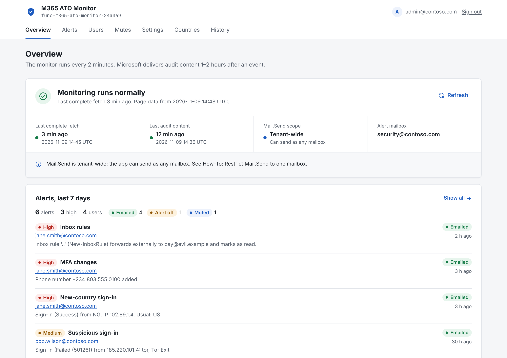

# M365 ATO Monitor

M365 ATO Monitor detects signs of account takeover in Microsoft 365. It runs in your Azure subscription and needs no Entra ID P2 or Defender license.

> [!IMPORTANT]
> The monitor checks for new audit records every 2 minutes. Alerts and automatic responses start only after Microsoft publishes the record. Some records take hours to arrive.

[Install](#install) · [What it detects](#what-it-detects) · [Detection limits](#what-it-does-not-detect) · [Documentation](#documentation)



## How it works

An Azure Function reads the unified audit log with a managed identity. It checks IP reputation with proxycheck.io. Each alert email gives investigation steps and lists other alerts for the user from the last 24 hours. The findings journal keeps alerts for 90 days.

### Example alert


## Requirements

- A Microsoft 365 commercial tenant with [unified audit logging](docs/GETTING_STARTED.md#unified-audit-logging) on.
- An Azure subscription in the same tenant and a region with Flex Consumption.
- A licensed or shared alert mailbox in the tenant.
- PowerShell 7.2 or later and Azure CLI 2.60 or later. You can use [Azure Cloud Shell](https://shell.azure.com) in PowerShell mode.
- An account with the [required Azure and Entra roles](docs/GETTING_STARTED.md#roles-for-the-person-who-installs).

## Install

From PowerShell 7, run the following commands. Replace the example mailbox and region with your own values.

```powershell
git clone https://github.com/Adversis/m365-ato-monitor.git
cd m365-ato-monitor
./install.ps1 -AdminEmail security@contoso.com -Location eastus
```

Check the tenant, mailbox, and permissions in the plan before you continue. Use `-DryRun` to preview the changes. Follow [Getting Started](docs/GETTING_STARTED.md) for each step and for troubleshooting.

### Install in another tenant

Run one installation per tenant. Use `-Tenant <domain>` to select it. Use `-List` to see saved installations and `-UpdateAll` to update them. See [Install in another tenant](docs/GETTING_STARTED.md#install-in-another-tenant).

## After installation

Run `./install.ps1 -Verify` to check the setup and run the detector self-test. Add `-SendTestAlerts` to send a test email for each alert type. See [what to expect after installation](docs/GETTING_STARTED.md#4-after-installation).

## Automatic response

Automatic response is off by default. With the required permissions, the monitor can revoke sessions, block sign-in, or turn off a malicious inbox rule. Configure these actions in **Settings > Automatic response**. See [Respond automatically to account-takeover alerts](docs/HOW_TO.md#respond-automatically-to-account-takeover-alerts).

## Management UI

Open the `/api/manage` link that the installer prints. Sign in with the account that installed the monitor. Use **Overview** to check health, **Alerts** to triage findings, and **Users** to investigate an account. See [How-To](docs/HOW_TO.md#where-to-change-what) for settings, access, and response actions.

## What it detects

| Detection | Examples | Severity |
| --- | --- | --- |
| Inbox rules | Forward to an external address; move mail to a folder that users seldom open; hide mail about payments or security; a rule named `..`. A rule that only deletes mail sends email only with another sign of takeover | High or medium |
| Mailbox forwarding | Forwarding to an external address (high) or an internal address (medium) | High or medium |
| Mail flow (transport) rules | External BCC or redirect; skip spam filtering | High or medium |
| OAuth consent | An app gets mailbox, file, or directory access, such as `Mail.Read` or `full_access_as_app` | High |
| MFA changes | A method added or replaced, or the default method changed, on an account that already has MFA; per-user MFA turned off. A method change sends email only after another alert, or after a sign-in from a new network. All methods removed: listed, no email | High or medium |
| Admin roles | Global Administrator or another admin role assigned | High or medium |
| Mailbox delegation | Full Access or Send As granted; a folder shared with everyone | Medium |
| App credentials | A secret or certificate added to an app registration | Medium |
| Domains and federation | Federation set on a domain; a domain added | High or medium |
| Protection turned off | Unified audit logging off; external auto-forwarding allowed; an anti-phishing policy removed | High or medium |
| Risky sign-in methods | Legacy authentication (password only, no MFA); device code sign-in; an attack tool or a scripting library in the user agent | High or medium |
| Suspicious sign-in IP | A sign-in from a VPN, Tor, proxy, or hosting address | Low to high |
| New country | A successful sign-in from a country that is new for the user. The monitor learns each user's countries for 14 days first | High |
| Stolen session | One sign-in session used from two countries, or used in the same country from a VPN, proxy, hosting, or Tor IP that did not sign in | High or medium |
| Mail access from a risky IP | Mail read or sent from a VPN, proxy, hosting, or new-country IP that did not sign in as the user in the last 7 days | High or medium |

IP reputation or a new country can raise the severity of a finding. Wrong-password attempts in suspicious sign-in, attack-tool, and automation-client detections send email only when **Email failed sign-ins** is on. A sign-in stopped by MFA or Conditional Access can still alert when this setting is off.

How each check works: [Architecture](docs/ARCHITECTURE.md#compromise-check). How to investigate each alert: [Alert Triage](docs/TRIAGE.md).

## What it does not detect

The monitor can miss a sign-in or stolen session from a residential IP in the user's country. Mail access checks need audit records for the action and a client IP. See [Detection limits](docs/ARCHITECTURE.md#detection-limits) for the full list.

## Cost

The software is free under the MIT license. Azure charges are about $1.50 per month for a tenant with fewer than 100 users, and a few dollars at 1,000 users. See [Costs](docs/ARCHITECTURE.md#costs) for what affects your bill.

## Documentation

- [Getting Started](docs/GETTING_STARTED.md) for installation and troubleshooting.
- [How-To Guide](docs/HOW_TO.md) for settings, updates, and common tasks.
- [Alert Triage](docs/TRIAGE.md) for investigation and response steps.
- [Documentation index](docs/INDEX.md) for technical references and development.
- [Changelog](CHANGELOG.md) for release changes.

## License

MIT
