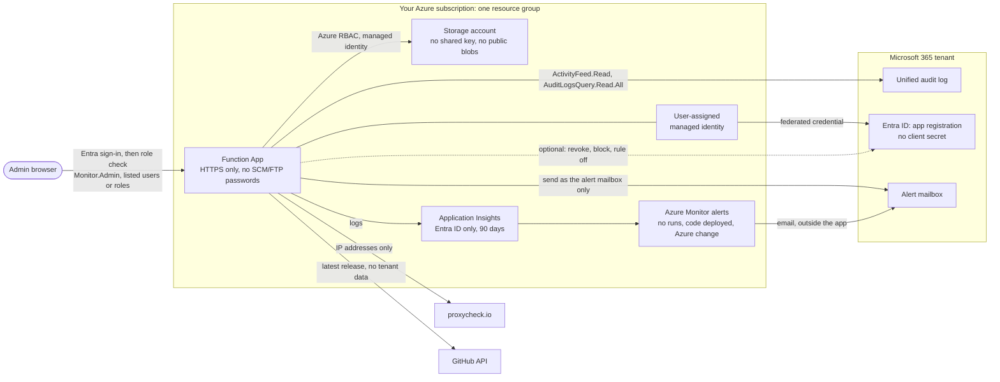

# Security

Permissions, secrets, protections, and known limitations.

## Architecture and controls

Everything runs in one resource group in your Azure subscription. Arrows show who calls whom, with the permission or control on the call.

The monitor sends IP addresses to proxycheck.io. The optional update check sends a public release request to GitHub. Alert emails can include audit records. The findings journal can retain audit details for 90 days.

## Permissions

`install.ps1` sets these permissions and grants admin consent through Microsoft Graph (app role assignments). A rerun removes the Graph roles that are no longer wanted.

| API | Permission | Type | When | Purpose |
|---|---|---|---|---|
| Office 365 Management APIs | `ActivityFeed.Read` | Application | Always | Read audit content. Start the audit subscriptions |
| Microsoft Graph | `User.ReadBasic.All` | Application | Always | List users for the inbox rule sweep; resolve UPN to object ID for alert links (`RESOLVE_USER_IDS`) |
| Microsoft Graph | `MailboxSettings.Read` | Application | Always, unless `MailboxSettings.ReadWrite` replaces it | Read the inbox rules of every mailbox (onboarding scan, user page). It can read the mailbox settings of every user (rules, automatic replies, time zone). It cannot read mail |
| Microsoft Graph | `AuditLogsQuery.Read.All` | Application | Always | Search the audit log in Microsoft Purview: up to 180 days of history for the onboarding scan, and the audit log search on the user page. It reads the same audit data as `ActivityFeed.Read`. Each user page search is in History. The scoped pair `AuditLogsQuery-Exchange.Read.All` and `AuditLogsQuery-Entra.Read.All` also works, with Exchange and Entra ID records only |
| Microsoft Graph | `RoleManagement.Read.Directory` | Application | Always | Read directory role assignments: who has Global Administrator and the other roles in Settings > Management UI access. Read only |
| Microsoft Graph | `Application.Read.All` | Application | Always | Read service principals: which tenant owns the app that made a change. An app consent by a Microsoft first-party app is journaled as "Microsoft service" and not emailed. MFA and role changes always alert. Read only. It reads app settings and credential metadata. It does not read secrets |
| Microsoft Graph | `Mail.Send` | Application | Only with `-MailSendScope tenant` | Send alert emails from `ADMIN_EMAIL`. With `-MailSendScope mailbox` (the default), Exchange Online RBAC for Applications grants "Application Mail.Send" for the members of the group `<name>-senders` only |
| Microsoft Graph | `User.RevokeSessions.All` | Application | Response permissions | Revoke sessions (automatic, and from the user page) |
| Microsoft Graph | `User.EnableDisableAccount.All`, `User.Read.All` | Application | Response permissions | Block and unblock sign-in (automatic, and from the user page); read account state |
| Microsoft Graph | `MailboxSettings.ReadWrite` | Application | Response permissions | Turn inbox rules off or on (automatic, and from the user page). It can change mailbox settings and rules of every mailbox. If necessary, limit it with RBAC for Applications |
| Microsoft Graph (management UI app) | `User.Read` | Delegated | Always | Sign-in to the management UI only |
| Application Insights resource | Monitoring Reader | Azure RBAC | Always | Read the monitor's own traces for the weekly and monthly reports |
| Health alert action group | Monitoring Contributor | Azure RBAC | Always | Set the action group email when the alert mailbox changes in the management UI. Scoped to that one action group |
| Storage account | Storage Blob Data Owner, Storage Table Data Contributor | Azure RBAC (managed identity) | Always | The Functions host (timers, code package) and the app's tables |

`install.ps1` grants the response permissions only if you answer yes (default) or use `-ResponsePermissions yes`. The responses stay off until you turn them on in the management UI. `-ResponsePermissions no` removes them.

Graph `Mail.Send` (Application) lets the app send as any mailbox in the tenant. The default install does not grant it: Exchange Online limits the app to the members of one group, which the app cannot change ([How-To](HOW_TO.md#limit-mailsend-to-the-alert-mailbox)).

Monitoring Reader applies to the one Application Insights resource only. It gives no access to mail, users, or the audit log.

## Management UI

The UI trusts its admins. It is not built to stop an attacker who already controls a `Monitor.Admin` account and targets this monitor. Such a person can change recipients, add mutes, weaken detection, and use the response actions. The controls below keep out people who are not admins. They also keep each change visible (History and an email to the alert mailbox).

Protections:

| Threat | Control |
|---|---|
| A person who is not an admin signs in | App Service Authentication with Entra ID: no anonymous request reaches the API. The sign-in app does not require assignment, so any user of the tenant can sign in. The code then allows only users with the `Monitor.Admin` role claim, the users listed in Settings > Management UI access, and the members of the directory roles listed there (active, direct role assignments, read from Microsoft Graph). Every other user gets HTTP 403 on each API request. |
| A forged identity header | The code trusts `X-MS-CLIENT-PRINCIPAL` only if App Service Authentication is on (`WEBSITE_AUTH_ENABLED`). The platform removes that header from client requests. If the code does not detect authentication, the UI returns 404 (fail closed). See [Known limitations](#known-limitations) for Flex Consumption. |
| Cross-site request forgery | Changes require `X-Monitor-Admin: 1`. When a browser sends `Origin`, its host must match an app host. The installer adds the app origin to CORS. Add only origins that serve the management UI. |
| Script injection | A strict Content-Security-Policy (`script-src 'self'`, no inline script). The page inserts audit data as text. |
| Clickjacking | `frame-ancestors 'none'` and `X-Frame-Options: DENY` |
| A silent change by an attacker | Each change is recorded in History and emailed to the alert mailbox. The email links to History. |
| Recipients changed | The alert mailbox, extra recipients, and the tenant name are UI settings. Each change is recorded in History and emailed. A new alert mailbox must pass a test send before the save, and the old address gets a notice. `install.ps1` sets the Graph permissions. The UI does not set them. |
| Invalid values | The server checks every value (types, ranges, addresses, country codes, ASNs, alert types). A setting that needs a missing Graph permission is refused. |
| Detection turned down | Alert types off, allowed IPs, and allowed networks ask for confirmation in the UI, are recorded in History, and are emailed. |
| Alerts muted | A mute requires a reason and expires within 3650 days. A high alert can match only if the mute names one eligible type, one user, and one ASN. History and email record each mute. The journal retains muted findings. |
| Accounts changed from the UI | The user page can revoke sessions, block or unblock sign-in, and turn inbox rules off or on, only as far as the app's Graph permissions allow. It refuses to block the alert mailbox and the admin's own account. Graph refuses changes to admin accounts. Each action is recorded in History and emailed. |
| Management UI session | The sign-in (App Service Authentication) lasts 8 hours, or the time set with `./install.ps1 -UiSessionHours`. Blocking an admin or revoking the admin's sessions does not end it. It ends only if Settings > Management UI access > **End the session of a blocked or revoked admin** is on. This setting is off by default. When it is on, each request reads the account from Graph. See [How fast a revoke or block applies](HOW_TO.md#how-fast-a-revoke-or-block-applies). |

If you set a webhook, alerts (user names, IP addresses, and the alert text, not the raw audit record) go to that service. The monitor posts over HTTPS only, does not follow redirects, and refuses a host that resolves to a private, loopback, link-local, or reserved address. The webhook URL is stored as a secret in Table Storage.

Keep the number of people with access small: the `Monitor.Admin` users, the listed users, and the members of the listed directory roles. Use accounts that have MFA. A change to the access settings is in History and is emailed to the alert mailbox.

## Credentials and secrets

There is no client secret and no storage key.

| Item | Where it is | Access |
|---|---|---|
| App credential | Nothing is stored. A user-assigned managed identity (`id-<name>`) is the only credential of the app registration (federated identity credential). For a Graph, Office 365 Management API, ARM, or Application Insights token, the app sends the managed identity token as the client assertion | Azure resources assigned this identity can request short-lived tokens. The app has no stored client secret to rotate |
| Storage access | No key. Shared key access is off after the install. The managed identity has Storage Blob Data Owner and Storage Table Data Contributor on the storage account | Azure RBAC |
| proxycheck.io API key | Table Storage (`monitoradmin`), written from the management UI (write-only setting) | The UI never shows it again. History and emails show "(set)" or "(replaced)". Readable by code in the Function App and by a person with table data access to the storage account |
| Function keys | Function App (App keys) | Needed for the script endpoints. Readable by a person with access to the Function App keys (`az functionapp keys list`). `install.ps1` reads the default key to call `/api/status` and `/api/selftest` and does not print it |
| Application Insights connection string | Function App setting | Not enough to send telemetry: local authentication is off, and the host sends with the managed identity (Monitoring Metrics Publisher). It does not give read access |
| Publishing credentials | None | Deployment with a user name and password (SCM, FTP) is off. A deployment needs an Entra ID token with write access to the Function App |
| Client secret (local development only) | `function/local.settings.json` | Only for `make dev` on your computer. It is in `.gitignore` |

`install.ps1` warns if the monitor app registration has a client secret. The monitor does not use it. Delete it: Entra admin center > App registrations > `<name>` > Certificates & secrets.

## SSRF guard

The Management API returns blob URLs in `contentUri` values and in the `NextPageUri` header. The app sends a bearer token to these URLs. Before each request, `o365_client._is_microsoft_content_url` checks that:

- the scheme is `https`, and
- the host is `manage.office.com` or ends with `.manage.office.com`.

The app does not follow a URL that fails the check, and logs an error. Because of this check, the app supports the commercial cloud only.

## Logging

- The proxycheck.io API must have the key in the URL query string. A `requests` exception text contains the full URL. The app removes the key from exception text before it logs it (`config.redact`).
- urllib3 logs the full URL at WARNING on each retry. The app sets the urllib3 logger to ERROR.
- Token errors log the HTTP status, the error name, and the AADSTS codes only. They do not log the response body.
- Logs contain UPNs, IP addresses, and inbox rule details. Control access to Application Insights.
- The app downloads Apple's public list of iCloud Private Relay IPs (`mask-api.icloud.com`) once a day. It sends no tenant data to Apple.
- Table Storage keeps, for 30 days, the Entra session IDs of users with the IPs and countries seen in each session (`signinsessions`). A session ID is not a credential. Still, control access to the storage account.
- Table Storage keeps, for 90 days, one row per finding (`monitorfindings`): user, type, description, IP, and what the monitor did. Control access to the storage account.
- The extra recipients (Settings > Email) can be outside the tenant. Alert emails contain UPNs, IP addresses, and audit records.

## Input handling

| Input | Source | Handling |
|---|---|---|
| Event `Id` (Table Storage RowKey) | Management API | `/ \ # ? ' "` and control characters become `_` |
| `ClientIP` | Management API | `clean_ip()` parses all known formats and returns the canonical form (IPv4-mapped IPv6 unwrapped, IPv6 lowercase and compressed) |
| Recipient addresses in rules and forwarding | Management API | The app checks every SMTP address in every forward field. A value with no SMTP address causes an alert. |
| Risk score | proxycheck.io | Integer, clamped to 0–100. 0 if not valid. |
| proxycheck.io per-IP result | proxycheck.io | Used only if it is an object with a `proxy` field |
| Latest release (update check) | GitHub API, once a day (`UPDATE_CHECK`) | Only a `MAJOR.MINOR.PATCH` tag is used. Drafts and pre-releases are skipped. The release link is shown only if it starts with `https://github.com/<UPDATE_REPO>/`. The answer is shown, never run: the monitor does not download or install code. The request has no sign-in and no tenant data |
| Values in alert emails | All sources | HTML-escaped. Links: the object ID must be a GUID; the href is escaped. |
| UPN in the Graph lookup URL | Management API | URL-encoded with no safe characters |
| `/api/recent` `hours`, `limit` | HTTP | Integers, clamped to 1–168 and 1–500. 400 if not integers. |

## HTTP endpoints

`/api/test`, `/api/health`, `/api/recent`, `/api/status`, `/api/selftest` need a function key (`auth_level=FUNCTION`). App Service Authentication excludes them (and the host admin API `/admin/*`), so they keep the function key. The Function App refuses plain HTTP (HTTPS only). `install.ps1` sends the key in the `x-functions-key` header, not in the URL.

- `/api/recent` returns a generic error text. Details go to Application Insights.
- `/api/status` returns error text from failed checks (secrets removed). It also returns the detection settings, `ADMIN_EMAIL`, the extra recipients, and the number of active mutes. A function key holder can read them.
- `/api/selftest?alert=true` sends an email. `/api/test` runs the monitor and uses proxycheck.io quota.

## CI

| Control | Setting |
|---|---|
| Token | `permissions: {}` for the workflow. Each job gets `contents: read`. Exceptions: CodeQL and Scorecard upload results (`security-events: write`), and the release job creates the release and its attestation. |
| Checkout | `persist-credentials: false`. The token is not kept in `.git/config`. |
| Actions and CI tools | Actions pinned to full commit SHAs. The CI tools (pip-audit, bandit, zizmor) pinned by hash in `.github/requirements`. Dependabot proposes updates after a 7-day cooldown. The app's own packages are not pinned: CI tests the newest versions that `function/requirements.txt` allows, as the deploy installs |
| Triggers | `pull_request`, not `pull_request_target`. Code from a fork runs with a read-only token and no secrets. |
| Secrets | None. CI does not deploy and has no Azure access. |
| `install.ps1` tests | Pester tests run the script against a fake `az`. They make no network call |
| Workflow changes | zizmor checks `.github` on each run |
| Code | bandit (Python, medium and high findings fail) on each run. CodeQL (`security-extended`, Python and JavaScript) on each push and weekly |
| Repository practices | OpenSSF Scorecard weekly, published for the README badge |
| Releases | A source archive with a signed build provenance attestation: `gh attestation verify m365-ato-monitor-vX.Y.Z.tar.gz --repo <owner>/m365-ato-monitor` |

CodeQL, Scorecard, and the attestation run only in a public repository. A private repository needs GitHub Advanced Security (CodeQL, Scorecard upload) and GitHub Enterprise Cloud (attestations).

Apply these repository settings (GitHub > Settings):

1. Rules > Rulesets: for `main`, block force-push and deletion. For the tags `v*`, block deletion and updates, so that a release tag always points to the released code. This repository has both. With more than one maintainer, also require a pull request and the five CI checks for `main`: Python tests and lint, Dependency audit, Static analysis (bandit), PowerShell (install.ps1), and Workflow security (zizmor), and CodeQL.
2. Actions > General > Workflow permissions: select "Read repository contents and packages permissions". Clear "Allow GitHub Actions to create and approve pull requests".
3. Advanced Security: turn on Dependabot alerts, secret scanning, and push protection (for a private repository, secret scanning needs GitHub Secret Protection).

## Known limitations

| Limitation | Risk | Mitigation |
|---|---|---|
| `Mail.Send` with `-MailSendScope tenant` | Code that runs as the app can send mail as any user | Use the default `-MailSendScope mailbox` ([How-To](HOW_TO.md#limit-mailsend-to-the-alert-mailbox)). A Global Administrator or Exchange Administrator can still add members to the group |
| Write access to the Function App | A person with Contributor (or Website Contributor) on the Function App can deploy code. That code gets the managed identity token and all the app's permissions | Restrict Azure RBAC on the resource group. Give Contributor only to administrators. Azure (not the app) emails the alert mailbox for each code deployment (`alert-<name>-code-deployed`) and each change to the Azure resources (`alert-<name>-azure-change`). The emails come after the change: they do not stop it. A person with Owner can also delete the alerts |
| proxycheck.io key in Table Storage | A person with table data access to the storage account (for example Storage Table Data Reader) can read the key | Shared key access is off, so only Azure RBAC gives access. The key gives access to proxycheck.io only |
| proxycheck.io key in the URL | The key is visible to proxycheck.io and to TLS-intercepting proxies | The API requires this. The app removes the key from logs. |
| Tokens in process memory | A memory dump shows bearer tokens | Tokens expire in 60–90 minutes |
| `/api/status` shows detection settings | A function key holder can learn what the app does not detect | Give function keys to administrators only |
| No rate limit on HTTP endpoints | A function key holder can use the proxycheck.io quota | Give function keys to administrators only |
| `/api/test` can run at the same time as the timer | Duplicate alerts are possible | Use it for tests only |
| Attacker-controlled IP fields in some Exchange records | A private `ClientIP` skips IP enrichment for that finding | The compromise alert is still sent |
| An outage longer than `MAX_CATCHUP_MINUTES` | Content in the gap is not fully processed | The app logs "Coverage gap" with the interval. The no-runs alert sends an email after 1 hour without a run. |
| Automated response (`revoke`, `disable`, inbox rule off) | A wrong geolocation, a wrong alert, or code that runs as the app can lock users out or turn off a legitimate rule | Off by default; exempt list; `ADMIN_EMAIL` exempt; 3 account actions per day; no action on admin accounts (no directory role); only high alerts about the account itself; rules are turned off, not deleted; undo steps in each alert |
| Management UI admin account compromised | The attacker can weaken detection (settings, mutes) and, with the response permissions, block users or turn off rules | Few people with access (Monitor.Admin, listed users, listed roles), all with MFA; change emails; History; Conditional Access if available; a mute hides high alerts only for one alert type, one user, and one network |
| `MailboxSettings.Read` is tenant-wide (always granted) | Code that runs as the app can read the mailbox settings and inbox rules of every user | Read only, no mail content. Restrict Azure RBAC on the resource group |
| iCloud Private Relay trusted (default) | An attacker who uses Private Relay causes no VPN alert | New-country, session, and compromise alerts still apply; the country comes from Apple's list; you can turn off the setting |
| IP geolocation | Wrong country for some IPs, mostly mobile networks | One alert per user and country per day; a country becomes normal after 3 days |
| Flex Consumption and `WEBSITE_AUTH_ENABLED` | Microsoft does not document whether Flex Consumption sets `WEBSITE_AUTH_ENABLED` when App Service Authentication is on. The management UI requires it | Fail closed: without it, the UI shows "The management UI is off: App Service Authentication is not detected" and never trusts the identity header. Alerts, reports, and `/api/status` still work. Do not set the variable by hand |
| Flex Consumption platform limits | The host must start within 30 seconds. A deployment to a stopped app reports success but starts no functions (a known Microsoft bug) | `install.ps1` starts the app before it deploys. The no-runs alert sends an email after 1 hour without a run |
| An admin-level attacker turns off unified audit logging | No content arrives | The `Set-AdminAuditLogConfig` record causes a high alert if it arrives. If no audit content arrives for `NO_CONTENT_ALERT_HOURS` (48 h), the monitor logs an error and the errors alert fires |
| Record formats checked against Microsoft documentation and public sample records, not a live tenant export | A detection can miss a record whose format differs | [API Compatibility](API_COMPATIBILITY.md#record-formats) lists the fields and what is not confirmed. Compare with a record from Microsoft Purview > Audit |

## Review history

See the [changelog](../CHANGELOG.md) for changes. The offline regression tests cover URL and input checks, log redaction, detector parsing, and automatic response eligibility.
